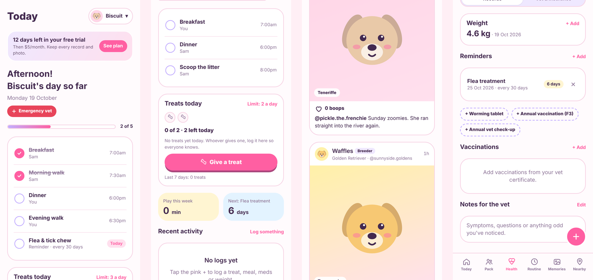

# Awoo

**Your pet's whole life, organised. For cat and dog pawrents.**

Awoo is a web app for busy pet parents who treat their cats and dogs like family. It keeps health records, reminders, treats, vet and insurance details and memories in one place, shared live with your partner, plus the Pack: a pets-only photo feed for your friends.



> **Status:** free beta. The $5/month plan after a 14-day trial is shown in the app but not charged yet.

## Features

| Area | What it does |
| --- | --- |
| **Today** | Daily routine to tick off, reminders that are due, recent activity, emergency vet button |
| **Treat tracker** | Log every treat with who gave it. Set a daily limit; the app warns before anyone goes over |
| **Shared household** | Invite your partner with a code. You both see the same pets, ticks, treats and reminders, live |
| **Cats and dogs** | Each pet is a cat or a dog, with cat routines (litter, play) and dog routines (walks) |
| **Health** | Weight chart, repeating reminders (flea, worming, heartworm, check-ups), vaccinations, notes for the vet |
| **Vet & insurance** | Policy number, cover, excess, claims line, annual limit left, your vet's details, a saved 24/7 hospital |
| **Emergency** | One tap to your saved hospital, your vet's number, or the nearest 24/7 animal hospital in Google Maps |
| **The Pack** | Pets-only feed: post photos, "boop" (like) posts, add friends |
| **Memories** | Photo album, milestones, birthday and gotcha-day countdowns |
| **Nearby** | Quick Google Maps searches for vets, parks, cafés, groomers, sitters, catteries and pet shops |
| **Home screen** | Add to Home Screen on iPhone or Android and it opens like an app |

## Quick start

1. Create a free [Firebase](https://console.firebase.google.com) project, turn on Email/Password and Google sign-in, and create a Firestore database.
2. Paste [`firestore.rules`](firestore.rules) into Firestore's **Rules** tab and publish.
3. Put your Firebase web keys into [`public/config.js`](public/config.js).
4. In [Netlify](https://app.netlify.com), import this repository. It publishes the `public` folder automatically.
5. Add your Netlify address and your domain under Firebase **Authentication > Settings > Authorized domains**.

Full step-by-step instructions: **[docs/SETUP.md](docs/SETUP.md)**.

Without Firebase keys, the app opens in preview mode with sample pets so you can click around. Nothing is saved in preview mode.

## Project layout

```
public/                 The website (this is what gets published)
  index.html            The whole app: screens, styles and logic
  config.js             App name and Firebase keys (the only file you edit)
  privacy.html          Privacy policy
  manifest.webmanifest  Home-screen app settings
  icon-*.png            App icons
firestore.rules         Database security rules (paste into Firebase)
netlify.toml            Tells Netlify to publish the public folder
docs/
  SETUP.md              Launch guide
  HOW-IT-WORKS.md       Technical overview for developers
```

## Built with

Plain HTML, CSS and JavaScript (no build step), [Firebase](https://firebase.google.com) Authentication and Cloud Firestore, hosted on [Netlify](https://www.netlify.com). Fonts: Fredoka and Nunito from Google Fonts.

## Roadmap

- Payments with Stripe (14-day trial, then $5/month)
- Push notifications for reminders and treats
- iPhone and Android apps in the App Store and Google Play
- Pro accounts for breeders and pet businesses

## Privacy

Pet records are private to each household. Pack posts are visible to everyone signed in. See [public/privacy.html](public/privacy.html).

## Licence

Copyright © 2026 Awoo. All rights reserved. This code is not licensed for reuse.
